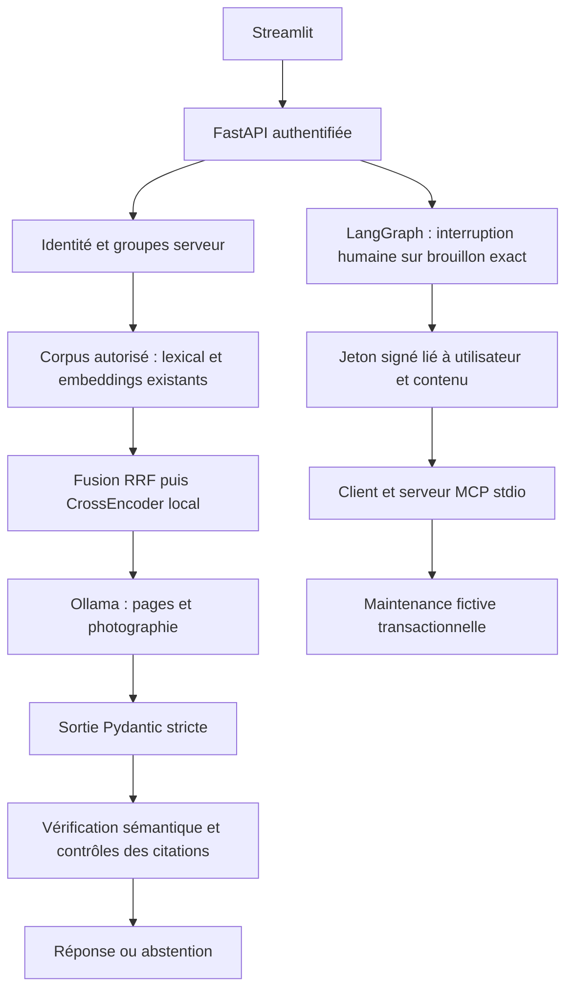

# Architecture MAINTiDOC — prototype local

Référence : cahier des charges transmis par l'utilisateur le 29 octobre 2026.
Le périmètre comprend deux familles, des documents autorisés, un VLM ouvert,
LangChain/LangGraph, MCP, des citations et une approbation humaine des tickets.

Les composants historiques sont conservés. Les modules intégrés ne les importent
pas lorsque leur import déclenche un traitement ou un appel Ollama.
Le nouveau corpus dérivé `elements_catalog.jsonl` réemploie les extractions.
Les versions documentaires inconnues restent nulles. Les groupes de
`config/document_access.json` sont une politique de démonstration, pas une
métadonnée extraite des manuels.

## Stockages et écarts explicites

Le mode local réutilise les tableaux NumPy et les images existantes ; les tickets
fictifs sont transactionnels dans SQLite. Ce mode facilite les essais et **ne
constitue pas la validation de l'architecture PostgreSQL/Qdrant/MinIO**.
`src/service_storage.py` fournit la synchronisation vers les trois services.
La branche Qdrant de la recherche applique un filtre serveur sur les groupes.
L'ouverture des sources utilise actuellement les fichiers locaux autorisés,
pas un téléchargement depuis MinIO. Un backend de tickets PostgreSQL est fourni et se sélectionne explicitement ;
son intégration n’est pas validée faute de serveur disponible. Aucun repli
SQLite automatique n’est effectué si ce backend échoue. Ces écarts sont à fermer avant une conformité complète.

L'index CLIP est facultatif dans le mode local ; son absence est affichée dans
les notes. Il doit être construit explicitement avec les deux encodeurs
compatibles. La recherche ne recalcule jamais les vecteurs des pages à la volée.

## Sécurité et budgets

- Jetons aléatoires, empreintes SHA-256 côté serveur ; aucun groupe issu du client.
- Filtrage avant recherche et nouvelle vérification à l'ouverture d'une source.
- Aucun outil de pilotage ; seuls trois outils fictifs figurent dans la liste MCP.
- Approbation signée, liée à l'utilisateur et au contenu, valable cinq minutes.
- Idempotence transactionnelle et journal des créations sans contenu brut.
- Trois appels MCP et six appels modèle maximum par requête (embeddings, reranking et VLM inclus) ; budget de 60 secondes.
- Délai réseau par appel VLM de 18 secondes ; pas de redirection ni de proxy.
- Une analyse API à la fois, six questions par utilisateur et par minute.
- Images de 5 Mo et 16 mégapixels maximum ; contexte et tokens limités.
- Inférence configurée CPU (`num_gpu=0`) ; la cible GPU 24 Go n'est pas validée.
- Les modèles locaux sont chargés avant l'acceptation des questions par le serveur.

Le contrôle sémantique est effectué par le VLM et renforcé par l'extrait exact,
la couverture des phrases, les identifiants, les repères et quelques termes
bilingues. Il peut encore commettre des erreurs : son efficacité doit être
mesurée sur des annotations humaines indépendantes.

Les identités sont destinées à une machine de démonstration de confiance.
Il n'y a pas encore de fournisseur OIDC, de rotation automatique des jetons,
de chiffrement de la base locale ou de rate limiter partagé multi-processus.
Les jetons `.local` doivent être protégés par les ACL Windows de l'utilisateur.
Ne pas exposer cette application sur Internet.

L’historique conversationnel est limité à dix tours et trente minutes, en mémoire,
avec isolation par utilisateur/session. Il est effacé à l’arrêt du serveur.
Les résultats affichés sont purgés au changement de jeton dans Streamlit.
